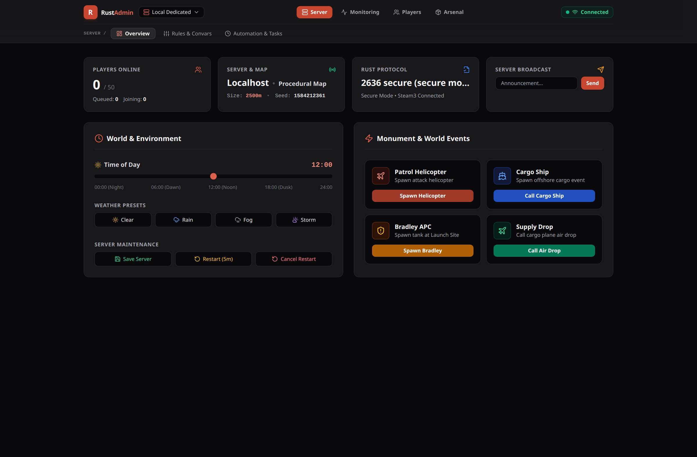
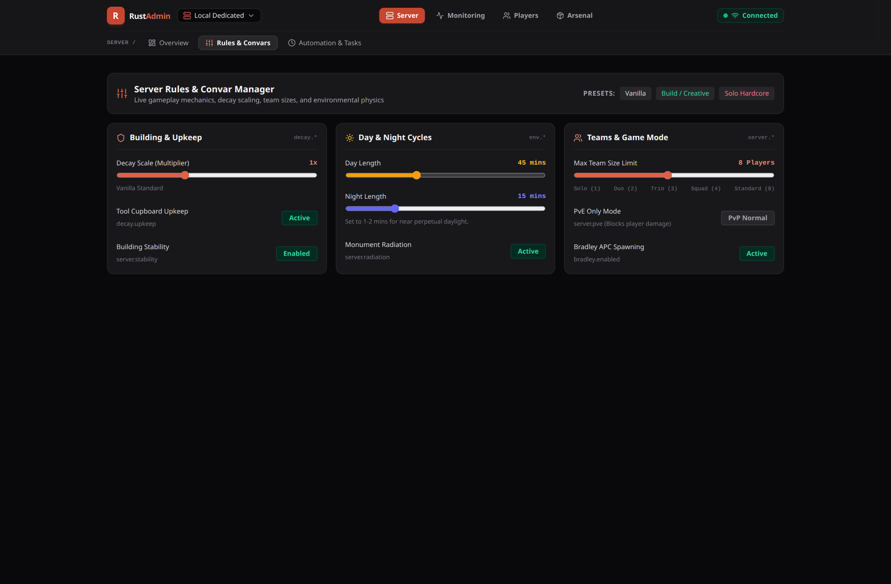
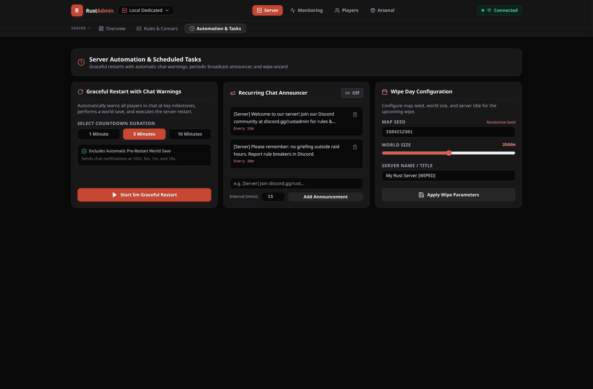
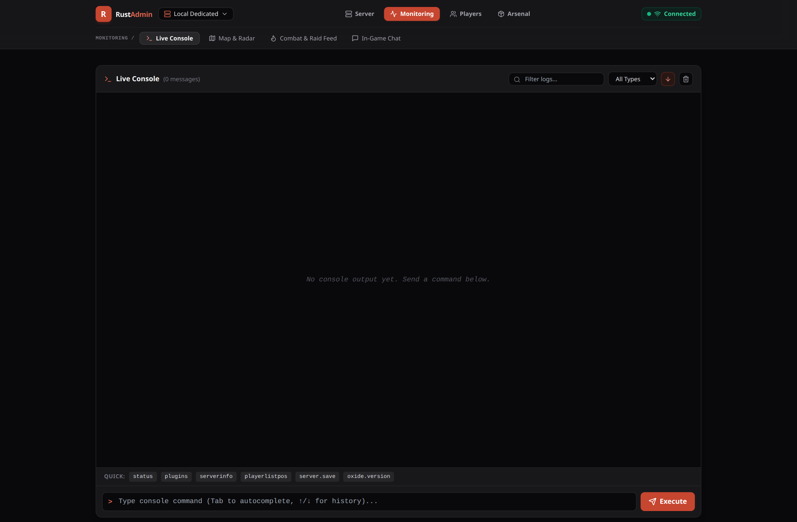
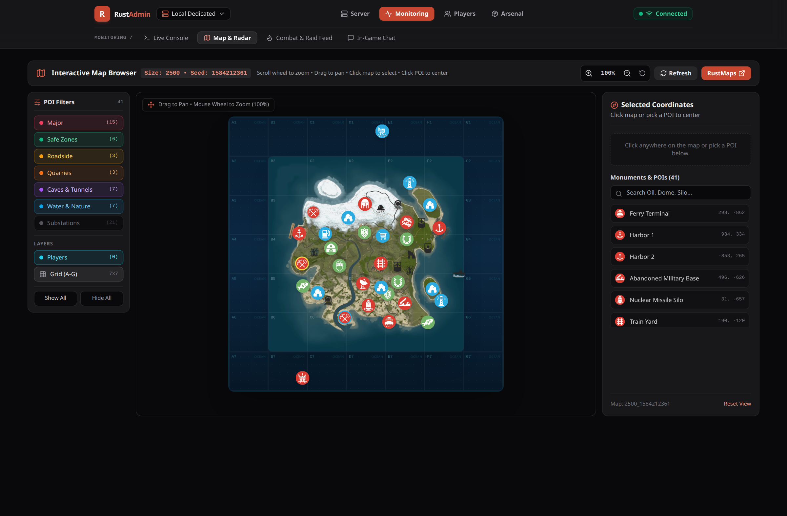
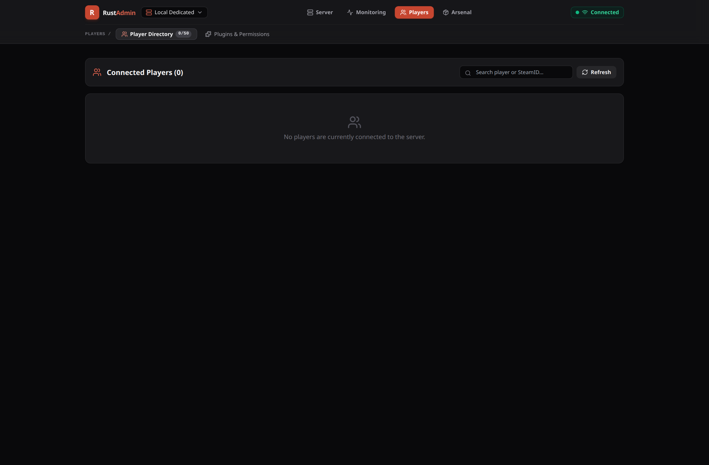
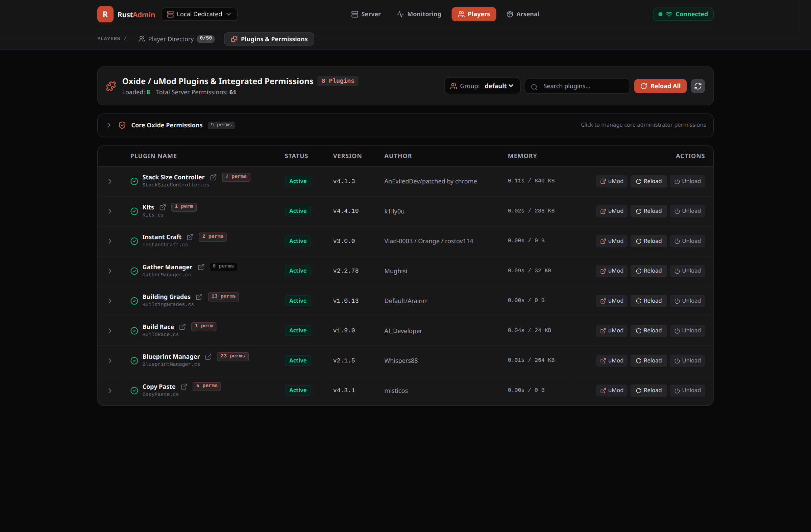
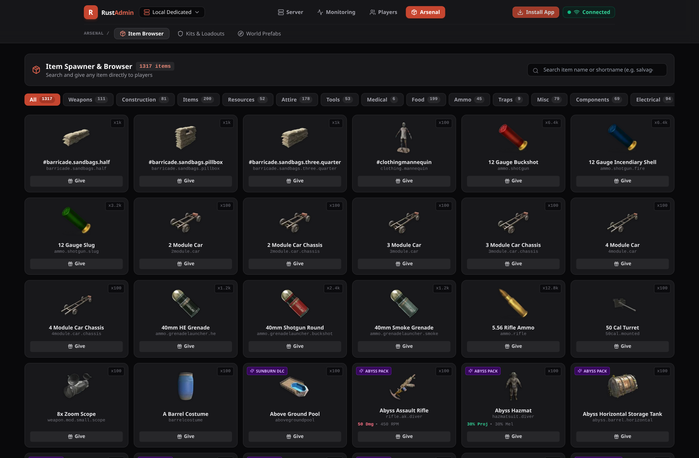
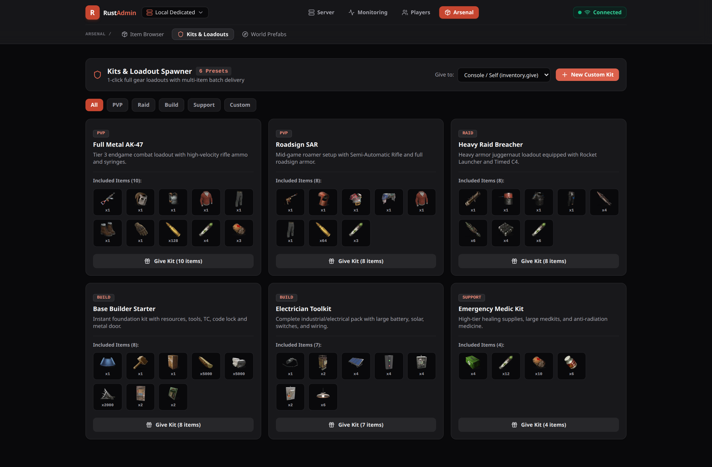

# RustCockpit WebRCON — Visual Tour and Screenshots

A visual walkthrough of the 12 core interfaces and tools in **RustCockpit WebRCON**.

---

## Table of Contents
1. [Server Overview and Dashboard](#1-server-overview-and-dashboard)
2. [Server Rules and Convars Manager](#2-server-rules-and-convars-manager)
3. [Automation, Graceful Restarts and Wipe Wizard](#3-automation-graceful-restarts-and-wipe-wizard)
4. [Live Console with Autocomplete and Multi-Level History](#4-live-console-with-autocomplete-and-multi-level-history)
5. [Interactive Live Map and Radar](#5-interactive-live-map-and-radar)
6. [Live Combat, Raid and Anti-Cheat Feed](#6-live-combat-raid-and-anti-cheat-feed)
7. [In-Game Global Chat and Broadcaster](#7-in-game-global-chat-and-broadcaster)
8. [Player Directory and Moderation](#8-player-directory-and-moderation)
9. [Oxide Plugins and Integrated Permissions Matrix](#9-oxide-plugins-and-integrated-permissions-matrix)
10. [Ultra-Fast Item Browser (1,317 Items & DLC Badges)](#10-ultra-fast-item-browser-1317-items--dlc-badges)
11. [Kits and Custom Loadout Spawner](#11-kits-and-custom-loadout-spawner)
12. [Vehicle and World Prefab Spawner](#12-vehicle-and-world-prefab-spawner)

---

### 1. Server Overview and Dashboard
Real-time server metrics, procedural map info card (seed, world size, protocol version), environmental time/weather controls, and instant world event triggers (Bradley APC, Patrol Heli, Cargo Ship, Supply Drop).

---

### 2. Server Rules and Convars Manager
Interactive sliders and toggles for building decay (`decay.scale`), upkeep, structural stability, radiation, day/night cycle lengths (`env.daylength`), AI behaviors (`ai.move`, `ai.think`, `ai.ignoreplayers`), persistence settings, team size limits, PvE mode, and one-click ruleset presets (*Vanilla*, *Creative Sandbox*, *Solo Hardcore*).

---

### 3. Automation, Graceful Restarts and Wipe Wizard
Scheduled multi-milestone restarts (10m, 5m, 1m, 10s warnings with automatic world save and one-click abort), background recurring chat announcer, and wipe day seed/worldsize configurator.

---

### 4. Live Console with Autocomplete and Multi-Level History
Live streaming RCON console with multi-level command history (<kbd>↑</kbd> and <kbd>↓</kbd> arrows through 100 entries), <kbd>Tab</kbd> completion, and dynamic active argument helper chips with clickable connected player SteamIDs.

---

### 5. Interactive Live Map and Radar
Interactive canvas rendering with monument POI icons, player location pings, and click-to-teleport actions.

---

### 6. Live Combat, Raid and Anti-Cheat Feed
Live combat events, raid explosion detector, and anti-cheat kicks.

---

### 7. In-Game Global Chat and Broadcaster
Real-time player chat stream with direct admin broadcast prompt.

---

### 8. Player Directory and Moderation
Player management directory with IP/SteamID lookup, inventory inspection, kick/ban actions, mute, and teleports.

---

### 9. Oxide Plugins and Integrated Permissions Matrix
Oxide/uMod plugin manager with grouped permissions matrix.

---

### 10. Ultra-Fast Item Browser (1,317 Items & DLC Badges)
Searchable item grid backed by a single WebP sprite sheet with sub-filters, item modals, crafting recipes, recycling yields, workbench levels, and buffs.

---

### 11. Kits and Custom Loadout Spawner
Built-in kit presets and visual kit creator.

---

### 12. Vehicle and World Prefab Spawner
Spawn air, land, and water vehicles as well as world deployables directly into the world.

